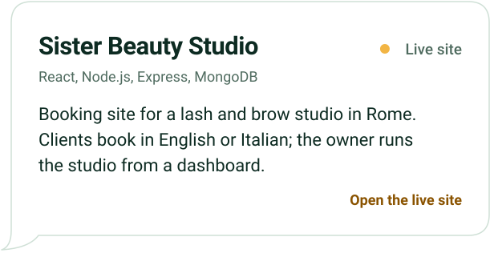
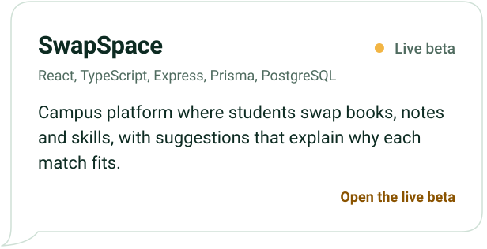

<picture>
  <source media="(prefers-color-scheme: dark)" srcset="assets/banner-dark.svg">
  
</picture>

I'm a software developer and a student at COMSATS University Islamabad. I build web apps, mobile apps and AI assistants, along with the backends and dashboards behind them, for businesses that use them every day.

I'm open to freelance projects and full-time roles.

### Things I've built

<a href="https://sister-beauty-azure.vercel.app"><picture>
  <source media="(prefers-color-scheme: dark)" srcset="assets/card-sister-beauty-dark.svg">
  
</picture></a>
<picture>
  <source media="(prefers-color-scheme: dark)" srcset="assets/card-whatsapp-dark.svg">
  
</picture>
<a href="https://swapspace-beta.vercel.app"><picture>
  <source media="(prefers-color-scheme: dark)" srcset="assets/card-swapspace-dark.svg">
  
</picture></a>
<a href="https://github.com/mfahim-dev/EduPulse"><picture>
  <source media="(prefers-color-scheme: dark)" srcset="assets/card-edupulse-dark.svg">
  
</picture></a>

### Tools I use

**Languages**

<picture>
  <source media="(prefers-color-scheme: dark)" srcset="https://skillicons.dev/icons?i=ts%2Cjs%2Cpython%2Cjava%2Ccpp%2Cc%2Ccs%2Cphp%2Cdart&perline=9&theme=dark">
  
</picture>

**Frontend and mobile**

<picture>
  <source media="(prefers-color-scheme: dark)" srcset="https://skillicons.dev/icons?i=html%2Ccss%2Creact%2Cnextjs%2Ctailwind%2Cbootstrap%2Cvite%2Cflutter&perline=8&theme=dark">
  
</picture>

**Backend and databases**

<picture>
  <source media="(prefers-color-scheme: dark)" srcset="https://skillicons.dev/icons?i=nodejs%2Cexpress%2Cprisma%2Cpostgres%2Cmysql%2Cmongodb%2Credis%2Csupabase&perline=8&theme=dark">
  
</picture>

**Cloud and DevOps**

<picture>
  <source media="(prefers-color-scheme: dark)" srcset="https://skillicons.dev/icons?i=docker%2Caws%2Ccloudflare%2Cvercel%2Cgithubactions&perline=5&theme=dark">
  
</picture>

**Tools**

<picture>
  <source media="(prefers-color-scheme: dark)" srcset="https://skillicons.dev/icons?i=git%2Cgithub%2Cvscode%2Cpostman%2Clinux%2Cvitest%2Csentry&perline=7&theme=dark">
  
</picture>

### My GitHub activity

<picture>
  <source media="(prefers-color-scheme: dark)" srcset="https://streak-stats.demolab.com?user=mfahim-dev&card_width=900&border_radius=20&background=232A33&border=3D4652&stroke=3D4652&ring=F2B544&fire=F2B544&currStreakNum=E6EDF3&sideNums=E6EDF3&currStreakLabel=F2B544&sideLabels=9198A1&dates=9198A1">
  
</picture>

<picture>
  <source media="(prefers-color-scheme: dark)" srcset="https://github-readme-activity-graph.vercel.app/graph?username=mfahim-dev&bg_color=232A33&color=9198A1&title_color=E6EDF3&line=F2B544&point=E6EDF3&area=true&area_color=F2B544&border_color=3D4652&radius=20&custom_title=Contributions%20in%20the%20last%2031%20days">
  
</picture>
